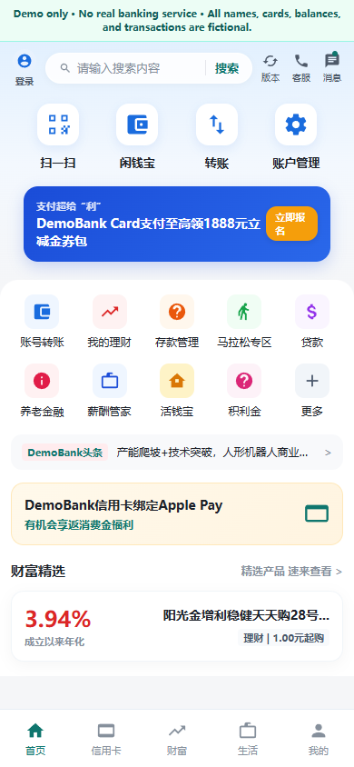
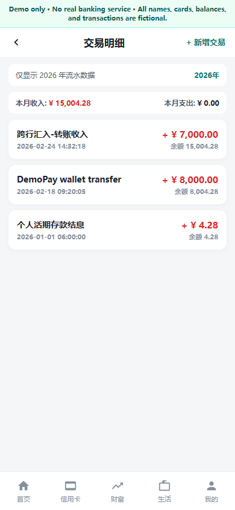

# DemoBank Mobile UI

> A responsive, offline mobile-banking interaction prototype built with plain HTML, CSS,
> and JavaScript.

> **Disclaimer:** This is an independent UI demonstration. It does not connect to a bank,
> provide financial services, or represent any real institution. Every name, card,
> balance, and transaction in the demo is fictional.



## Features

- Mobile-first account overview and asset dashboard
- Multiple tab pages and animated navigation
- Card creation, editing, deletion, and masked balances
- Transaction creation, editing, deletion, and filtering
- Local persistence through `localStorage`
- Responsive layout with no backend or external network requests
- Portable single-file build in `dist/demo-bank.html`

## Pages

| Page | Main interactions |
|---|---|
| Home | Service shortcuts, notices, and promotional content |
| Accounts | Asset summary and card list |
| Assets | Demand deposit, wealth products, and account controls |
| Profile | User preferences and demo identity |
| Transactions | Income/expense summary and transaction CRUD |



## Stack

- Semantic HTML5
- CSS custom properties, Flexbox, responsive layout
- Vanilla JavaScript classes
- Browser `localStorage`
- Inline SVG artwork

## Run locally

From the project root:

```powershell
python -m http.server 8080
```

Then open `http://localhost:8080/`.

To build the portable version:

```powershell
python tools/build_single_file.py
```

The result is written to `dist/demo-bank.html`.

## Project structure

```text
.
├── index.html
├── manifest.json
├── src/
│   ├── css/style.css
│   └── js/
│       ├── app.js
│       └── mockData.js
├── assets/
├── docs/FEATURES.md
├── tools/build_single_file.py
└── dist/
    ├── demo-bank.html
    └── manifest.json
```

## Verification

The implementation is intentionally client-only. Basic verification covers:

- page and tab navigation;
- add, edit, and delete card records;
- add, edit, and delete transaction records;
- balance recalculation;
- reload persistence with `localStorage`;
- no browser console errors.

Open [docs/FEATURES.md](docs/FEATURES.md) for the interaction inventory.
